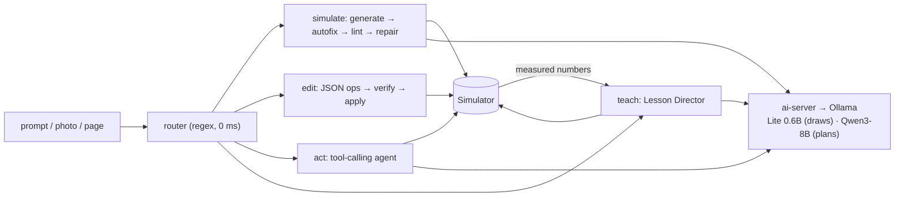

# SIMBLIP AI

**A fine-tuned small model, a verified generation pipeline, a permission-gated tool-calling agent and a simulator-grounded lesson director: the AI layer of [SIMBLIP](https://github.com/RohanS358/simblip), the engineering notebook that simulates.**

[](https://github.com/RohanS358/simblip_ai/actions/workflows/ci.yml)


> **This repository is a part of the main project, [SIMBLIP](https://github.com/RohanS358/simblip) ([live app](https://simblip.rohan-singh.com.np)), by Rohan Singh.**
> It contains **only the AI part**, extracted and modularised, and it is submitted to **Frogtoberfest 2026** as the *Build with AI* entry.
> The simulator it drives is vendored read-only (see [`SUBSTRATE.md`](SUBSTRATE.md)); everything else here is the AI system.

---

## The problem

Students learning engineering can read a derivation but cannot *see* it: a circuit settling, a projectile peaking, a pointer walking a tree. Chatbots answer in prose; the numbers in that prose are often wrong, and nothing on screen reacts.

## What this does

You type or say what you want. The AI **builds, edits, measures and teaches inside a live simulator**, and every number a student reads comes from the simulator or a calculator, never from the model's guess.

| You say | The AI does | Where |
|---|---|---|
| "build an RC low-pass filter at 1 kHz" | writes a scene, **lints and repairs it**, runs it; the circuit appears wired, labelled and plotted | [`lib/ai/generate.ts`](lib/ai/generate.ts) |
| "make the bob heavier" | emits a verified JSON edit; applied as **one undo step** | [`lib/ai/edit-ops.ts`](lib/ai/edit-ops.ts) |
| "how fast is the ball?" | picks a tool, runs it against the simulation, reads the measured value | [`lib/tools/`](lib/tools) |
| "teach me projectile motion" | plans a lesson, draws each scene, **measures the real numbers**, asks you to predict first, narrates | [`lib/lesson/director.ts`](lib/lesson/director.ts) |
| *a photo of an exam question* | solves it step by step; **every arithmetic line recomputed** by code and corrected out loud if the model slipped | [`lib/lesson/solve.ts`](lib/lesson/solve.ts) |

The design rule behind all of it:

> **The model chooses *what to show*. Code decides *whether it is valid* and *what the numbers are*.**

## For evaluators: the minimum requirements

| Requirement | Status | Where to look |
|---|---|---|
| Public GitHub repository, runnable | ✅ | this repo; `npm ci && npm test` runs **557 tests in about 30 s, no GPU needed** |
| README | ✅ | you are reading it |
| Architecture overview | ✅ | [`docs/ARCHITECTURE.md`](docs/ARCHITECTURE.md) |
| Technology details | ✅ | [Technology](#technology) below, [`docs/FINE_TUNING.md`](docs/FINE_TUNING.md), [`docs/EVALUATION.md`](docs/EVALUATION.md) |
| Limitations / future improvements | ✅ | [`docs/LIMITATIONS.md`](docs/LIMITATIONS.md) |
| Qualifies as "Build with AI" (AI does core logic, not just displayed text) | ✅ | [Why this is *Build with AI*](#why-this-is-build-with-ai) |
| **AI usage disclosure** (exact file / function where AI output is consumed programmatically) | ✅ | [`docs/AI_USAGE_DISCLOSURE.md`](docs/AI_USAGE_DISCLOSURE.md): 11 consumption points, each with its safeguard |
| Working demo | 🔜 | linked here at submission; the whole stack also runs locally ([below](#run-it)) |
| Demo video / presentation | 🔜 | linked here at submission |

A **guided 10-minute path** through the repository, with the expected output of every command, is in [`docs/EVALUATOR_GUIDE.md`](docs/EVALUATOR_GUIDE.md).

## Why this is *Build with AI*

The brief says AI must *process, transform or reason over data as part of core logic, not just generate a displayed response*. Here, the model's output is **parsed, validated and executed by code** at every step:

* **SimScript** from the model → `autofixSimScript()` → `lintSimScript()` → repair loop → **the interpreter creates simulator objects**.
* **JSON edit plans** → `verifyPlan()` against the live page → `applyPlan()` **mutates the document** (one undo step).
* **Tool calls** → zod validation → permission gate → `runTool()` **executes real actions** on the simulation.
* **Lesson plans** (grammar-constrained JSON) → `routePlan()`, where *code overrides the model's choice of lab* → scenes **run in the real engine** → numbers **measured**, not generated.
* **Worked solutions** → `checkArithmetic()` **recomputes** every line.

It also **uses tools and external systems**, **holds context** (conversation memory, page awareness, learner state) and **takes action** (builds, edits, runs, opens pages, schedules review), the other criteria in the Frogtoberfest brief.
The full table, with file and function names, is in [`docs/AI_USAGE_DISCLOSURE.md`](docs/AI_USAGE_DISCLOSURE.md).

## Results

Measured on an RTX 4060 Laptop (8 GB). Scenes are judged by **executing them in the real simulator**, not by a person or another model
(`pass-all` = lints + simulates stably + looks right + teaches). Recompute any row with `npm run results`.

| Model, 30 novel prompts never seen in training | Valid | **Pass-all** |
|---|---:|---:|
| Qwen3-8B base + the full ~1,000-token SimScript prompt | 43 % | **0 %** |
| SIMBLIP Lite Q4_K_M (0.6B fine-tune, 397 MB) | 83 % | 83 % |
| **SIMBLIP Lite Q8_0 (0.6B fine-tune, 640 MB), served** | 97 % | **93 %** |
| Qwen3-1.7B fine-tune (same data) | 97 % | 93 % *(no gain, so not promoted)* |
| Lite Q8_0 end to end through `ai-server` | 93 % | 90 % |

Also: 99 % on 80 held-out prompts; tool calling **100 % schema-valid and 100 % correct tool** on 30 held-out prompts (73 % exact arguments in the committed run, and why is explained); a red-team suite for the tool layer.
Every claim, and where it is weak, is in [`docs/EVALUATION.md`](docs/EVALUATION.md).

## How it works



1. **Models.** Two jobs, two models. **SIMBLIP Lite**, a Qwen3-0.6B fine-tune, *draws* (writes SimScript); a larger Qwen3-8B *plans, explains and picks tools*. Lanes are aliases in [`ai-server/models.json`](ai-server/models.json), so a model can be swapped without changing code. A 1.7B tier runs **on-device in the browser** (wllama, WebGPU/WASM) through the same pipeline.
2. **Fine-tuning.** Training data is **generated, not scraped**: recipes write good scenes, every one is **run in the simulator and scored**, and only passing rows survive (6,409 of 7,000 candidates at v3). QLoRA, 20.2 M trainable parameters, 60 minutes on a laptop GPU. → [`docs/FINE_TUNING.md`](docs/FINE_TUNING.md)
3. **Verification is free, generation is not.** The linter checks everything decidable from the text against the *runtime's own registries*, in microseconds, so the common case pays nothing for safety and only a real failure costs a model round (max 2). Measured: the earlier 103-tool agent used 17,981 prompt tokens and up to 24 rounds; this uses 1,021 tokens and one.
4. **Tools.** 26 tools in one registry; the on-device agent, the MCP bridge (so Claude Code or any MCP client can drive the notebook) and WebMCP are all adapters over it. A small model is shown **at most 4** candidate tools, not 40.
5. **Lessons.** "Teach me X" becomes a narrated, interactive film. The model only chooses *what to show*; the simulator measures every result; a wrong-lesson guard stops an authored lesson playing for the wrong topic; the planner may answer *unsure*; a film with nothing simulatable says it is **not verified**.
6. **Serving.** [`ai-server/`](ai-server) is an Ollama-compatible gateway with constant-time bearer auth, a per-client rate limit, a bounded FIFO queue (one 8 GB GPU is not a free-for-all), cancel-on-disconnect and content-free logs. Zero dependencies.
7. **Trust.** The AI has no private way to change anything: every tool wraps an action a user can already perform, so it syncs, persists and **undoes** for free. Permission gate at the registry; injected lesson text is fenced data; hostile arguments never throw.

Read next: [`docs/ARCHITECTURE.md`](docs/ARCHITECTURE.md) has the diagrams and the five request flows step by step.

## Run it

**Tests, no GPU, about 30 s** (Node 24, pinned in `.nvmrc`; the attachment test downloads ~5 MB of OCR data on its first run):

```bash
git clone https://github.com/RohanS358/simblip_ai.git && cd simblip_ai
npm ci
npm test                 # 550 AI tests + 7 server tests
npm run typecheck        # tsc --noEmit
npm run results          # recomputes the results table from results/*.json
```

**The full AI stack** (needs [Ollama](https://ollama.com) and a GPU with about 8 GB):

```bash
# 1. models: see models/README.md for the GGUF and its SHA-256
ollama create simblip-lite-q8 -f ai-server/Modelfile.simblip-lite     # simblip-lite-Q8_0.gguf beside it
ollama pull qwen3:8b

# 2. the server
export AI_SERVER_KEY=$(openssl rand -hex 32)
npm run ai-server                                                       # 127.0.0.1:8787

# 3. ask for a scene
curl -s localhost:8787/api/chat -H "Authorization: Bearer $AI_SERVER_KEY" -H 'Content-Type: application/json' -d '{
  "model": "simblip-script", "stream": false,
  "messages": [{"role":"user","content":"a 9 V battery with two 100 ohm resistors in series, plot the current"}]}'
```

Optional neural narration voice: `bash ai-server/tts/setup.sh && npm run ai-tts`. Expose the MCP bridge with `npm run mcp`. Environment variables are in [`.env.example`](.env.example).

## Repository map

```
ai-server/            Ollama-compatible gateway: auth · queue · lane aliases · Kokoro TTS sidecar · tests
lib/ai/               generation pipeline, linter, autofix, router, edit ops, explain, arithmetic check,
                      placement, quality scorer, on-device engine (engine/), tutor agent (tutor/)
lib/tools/            the 26-tool registry, MCP/WebMCP bridge, red-team tests
lib/lesson/           Director, planner, solver, storyboard, player, stage, teacher
lib/learning/         FSRS scheduler, BM25 retrieval, flash cards, hint ladder (no model)
lib/sketch/           sketch → Scene IR → SimScript compiler; trainable stroke recognizer
lib/teacher/ tts/ frame/   teacher rig, speakable text + caption clock, frame loop
scripts/ai/           data/ (recipes, dataset builder) · train/ (QLoRA, merge) · eval/ · quality/
scripts/mcp/          the MCP server
models/               LoRA adapter + how to get the GGUFs
data/                 the v5 fine-tuning set (gz) and the quality-gate report
results/              every scored output and loss curve behind the numbers above
docs/                 ARCHITECTURE · FINE_TUNING · EVALUATION · AI_USAGE_DISCLOSURE · LIMITATIONS · HISTORY · decisions log
SUBSTRATE.md          the vendored simulator (read-only) the AI runs against
content/courses/      125 authored lessons the Lesson Player can convert (used by tests)
```

## How it was built

The history is the build order. Each feature is its own branch, merged with `--no-ff`, with original commit dates and a pointer to the SIMBLIP commit it came from:
[`docs/HISTORY.md`](docs/HISTORY.md). In short: a verified SimScript pipeline first (July to August); then, from October, the tool registry and agent, the dataset gate and the fine-tune, the separate server,
the red-team suite, the Lesson Director and teacher, simulator-grounded numbers, and solving brought material.
Every design decision, with the evidence behind it and what would change it, is in [`docs/ai/decisions.md`](docs/ai/decisions.md).

## Technology

| Concern | Choice |
|---|---|
| Base model, fine-tuned | **Qwen3-0.6B** (Apache-2.0), QLoRA via **PEFT + bitsandbytes** (NF4, bf16), merged, **GGUF Q8_0** via llama.cpp |
| Larger lane | **Qwen3-8B** on **Ollama** (planning, explanations, tool selection) |
| On-device | **wllama** (llama.cpp in WebAssembly, WebGPU) with Qwen3-1.7B Q4_K_M |
| Voice | **Kokoro-82M** (ONNX, CPU), 54 voices |
| Language / runtime | TypeScript (strict) on Node 24 with native type stripping; Python for training |
| Validation | **zod** schemas wherever a model's output enters code; JSON-Schema grammar-constrained decoding for plans |
| Agent surface | In-house tool registry; **Model Context Protocol** SDK for the bridge; WebMCP |
| Retrieval / review | BM25 and FSRS-4.5, both hand-written, no model |
| Tests | `node:test`, 557 tests, GitHub Actions CI |

## Limitations

The 0.6B model cannot yet write complete transistor circuits unprompted, so exact recipes cover the textbook cases and the rest fall back to concept diagrams, honestly labelled; the novel-prompt set is small and saturated;
the quality scores are our own proxies; English only. The full list, and what comes next, is in [`docs/LIMITATIONS.md`](docs/LIMITATIONS.md).

## Credits and licence

**SIMBLIP and its AI layer are by Rohan Singh.** Built for Frogtoberfest 2026. Code assistance: Claude Code, as stated per commit and in the [disclosure](docs/AI_USAGE_DISCLOSURE.md).
Open models used under their own licences: Qwen3 (Apache-2.0), Kokoro-82M (Apache-2.0); runtimes: llama.cpp (MIT), Ollama (MIT), wllama (MIT).
This repository is released under the [MIT licence](LICENSE).

<!-- DEMO: add the live-demo link and the video here (and flip the two 🔜 rows above) at submission -->
