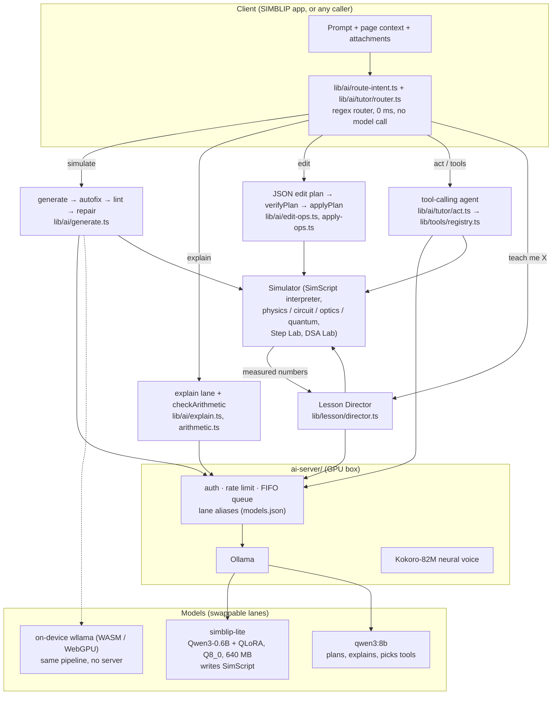
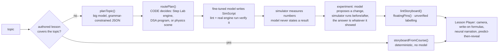

# Architecture

This is the AI layer of **SIMBLIP**, an engineering notebook whose canvas is a live simulator. The AI does not
chat about physics; it **builds, edits, measures and teaches inside the simulator**, and every claim it makes is
checked by code before a student sees it.

One design rule runs through everything:

> **The model chooses *what to show*. Code decides *whether it is valid* and *what the numbers are*.**

A 0.6B–8B model is good at choosing and phrasing and bad at arithmetic, physics and structural consistency. So each
place the model is used is wrapped by a deterministic verifier, and every number a student reads comes from the
simulator or a calculator, never from the model's prediction.

## 1. The system at a glance

The simulator on the right is the host app's engine. This repository vendors the headless parts the AI needs
(see [`SUBSTRATE.md`](../SUBSTRATE.md)); everything else here is the AI system.

## 2. Layers

| Layer | Path | Responsibility |
|---|---|---|
| **Models** | `Modelfile`, `ai-server/Modelfile.simblip-lite`, `ai-server/models.json`, `lib/ai/engine/` | Which weights serve which job. Lanes are aliases, so a model can be swapped without touching code. `engine/` is the in-browser llama.cpp (wllama) runtime. |
| **Serving** | `ai-server/` | Ollama-compatible gateway: constant-time bearer auth, per-client rate limit, bounded FIFO queue (one 8 GB GPU is not a free-for-all), cancels the GPU job when the client disconnects, logs latency/tokens but never content. Zero dependencies (`node:http`). Plus the Kokoro TTS sidecar. |
| **Routing** | `lib/ai/route-intent.ts`, `lib/ai/tutor/router.ts` | Pure regex; chooses a lane in 0 ms. A classifier round would cost more than the generation it routes. |
| **Generation** | `lib/ai/generate.ts`, `simscript-fix.ts`, `simscript-lint.ts`, `few-shot.ts`, `cache.ts` | Model writes SimScript; deterministic autofix and a registry-derived linter verify it; a repair loop (max 2) feeds linter errors back as instructions. |
| **Editing** | `lib/ai/edit.ts`, `edit-ops.ts`, `apply-ops.ts` | The model emits a *closed-vocabulary JSON op list*; every id and component is checked against the live page before anything runs; the whole batch is one undo step. |
| **Tools / agent** | `lib/tools/`, `lib/ai/tutor/act.ts` | 26 tools in one registry. Zod-validated arguments, effect classes (`read` / `write` / `run`), permission gate, red-team tested. The on-device agent, the MCP bridge and WebMCP are all adapters over the same registry. |
| **Lessons** | `lib/lesson/`, `lib/learning/`, `lib/teacher/`, `lib/tts/` | "Teach me X" becomes a narrated, interactive film. The Director plans with the big model, the fine-tuned model draws each scene, the simulator supplies every number. FSRS + BM25 handle review and retrieval with no model. |
| **Sketch** | `lib/sketch/` | Handwriting/sketch → Scene IR → SimScript compiler (no model in the compile step), plus the trainable stroke recognizer. |
| **Training & eval** | `scripts/ai/` | Recipe-based dataset builder with a quality gate, QLoRA SFT, merge, held-out and novel-prompt evaluation, scene-quality scorer. |

## 3. The five flows

### 3.1 Simulate: "build an RC low-pass filter"

1. `classifyIntent()` → `simulate`.
2. `generateSimScript()` asks the fine-tuned model for SimScript (one line of system prompt: the language is in the weights).
3. `autofixSimScript()` repairs unambiguous slips (`.voltage` → `.V`, `battery.a` → `battery.positive`, `create("cap")`) with a lookup table. **Deliberately not** fixed: a missing anchor, because choosing a terminal would invent wiring.
4. `lintSimScript()` checks everything decidable from the text against the *same registries the runtime uses* (component kinds, anchors, channels, params, multi-pin completeness). Errors are phrased as repair instructions.
5. If errors remain, the model gets "here is your script, here are the errors, fix exactly these" (max 2 rounds).
6. Only a verified script reaches the interpreter. Then the quality scorer is available for offline checking.

Why not tool-calling for scenes? Measured on the same prompt: the old 103-tool agent used **17,981** prompt tokens and up to 24 rounds
(~11.9 s); the SimScript pipeline uses **1,021** tokens and one round (~2.2 s). A scene is simply denser as code.

### 3.2 Edit: "make the bob heavier"

SimScript is create-only, so "edit" would force the model to re-emit the scene (the duplication failure that once produced 109 objects).
Instead the model emits a **JSON op list** in a closed vocabulary. `verifyPlan()` checks each op against the live page (object exists,
component exists, behavior exists). `applyPlan()` re-verifies immediately before applying and applies the batch as **one undo step**.
Half a patch is never applied.

### 3.3 Act: "how fast is the ball?", "open my circuits page"

`routeAct()` decides whether a request needs tools. Quick tools ("run", "undo") never reach a model. For the rest, the model is shown **≤ 4** candidate tools
(a 1–2B model shown 40 tools picks badly). `runTool()` validates arguments with zod, enforces the permission gate and the agent mode
(`off` / `read` / `full`) **at execution time, not just in the tool list**, and never throws: failures become text the model can read and retry.

### 3.4 Teach: "teach me projectile motion"

Safeguards worth naming: a **wrong-lesson guard** (`covers()` in `lib/learning/bm25.ts`: an authored lesson plays only if it covers the topic's
distinctive words), the planner may answer **`unsure`** instead of inventing a lesson, an experiment whose change moves nothing is **dropped**
(never taught as "no effect"), and a film with no simulatable scene opens by saying it is **not verified by the simulator**.

### 3.5 Solve / teach brought material

A photographed question, a pasted problem, or an attached PDF/DOCX goes to `teach.material` → `lib/lesson/solve.ts`. The planner writes a worked solution in the
normal lesson shape; `verifySolution()` **recomputes every worked line** with `checkArithmetic()` and a wrong one is corrected out loud, because a language model
predicts the digits of `0.025 / 0.004394 =` instead of computing them.

## 4. Safety and trust boundaries

* **Nothing the AI does is a private way to change the canvas.** Every tool wraps an action a user can already perform, so it syncs, persists and undoes for free.
* **Prompt-injection posture:** lesson/page excerpts are returned to the model as *fenced data* and trigger no effect (`lib/tools/redteam.test.mjs`).
* **Permission gate at the registry:** a student account cannot run any gated teacher tool whatever the arguments; permanent deletion is not a tool at all.
* **Hostile arguments never throw:** wrong types, prototype keys, huge strings, nulls and look-alike tool names are refused, not fuzzy-matched.
* **MCP bridge** binds `127.0.0.1`, refuses non-SIMBLIP browser origins at the socket, and needs user approval before the first tool runs.
* **AI server** refuses to start without a key, compares it in constant time, rate-limits, bounds the queue, and logs no content.
* **Privacy:** the on-device engine means nothing a student types or draws has to leave the device; learner state stays local unless the user turns sync on.

## 5. Decisions and their evidence

The running log is [`docs/ai/decisions.md`](ai/decisions.md) (append-only: date · decision · evidence · what would change it). Highlights:

| Decision | Evidence |
|---|---|
| Serve a **0.6B fine-tune**, not a larger base | 93 % pass-all vs **0 %** for the 8B base with the full prompt on 30 novel prompts |
| **Keep** the 0.6B, do not train a 4B | The 1.7B fine-tune scored the same (93 % / 92.6 vs 92.4); the set is saturated, so a harder set comes first |
| Q8_0 over Q4_K_M | Q4 lost ~10 points (83 % vs 93 %) |
| Planning in code, not in the prompt | The 8B planner ignored an instruction to use the lab and produced physics scenes for "teach me DFS"; routing moved into `routePlan()` |
| BM25, not embeddings | 0 MB of model RAM, honours course grants; revisit only if recall is measured insufficient |
| FSRS hand-rolled | Deterministic, 10 tests, no dependency |
